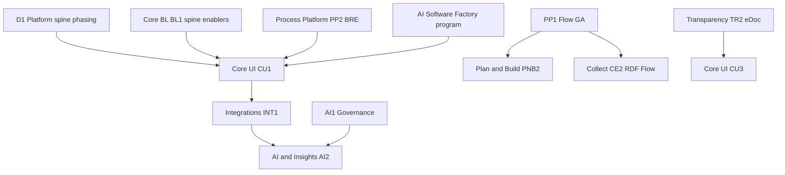

# Proposed product team objectives — 2026–2027

**Purpose:** Step 2 of the objective refresh. Concrete proposals for QCLT negotiation before team workshops.  
**Parent:** [`team-objectives-strategy-brief-2026.md`](team-objectives-strategy-brief-2026.md) · AI detail: [`agent-strategy-appendix-d7.md`](agent-strategy-appendix-d7.md)  
**Workbook (shaped objectives + draft KRs):** [`team-objectives-refresh-workbook-2026.md`](team-objectives-refresh-workbook-2026.md) — **authoritative detail for LPM workshops**  
**QCLT meeting pack:** [`qclt-objectives-alignment-pack-2026.md`](qclt-objectives-alignment-pack-2026.md) · decision sheet: [`qclt-objectives-decision-sheet-2026.md`](qclt-objectives-decision-sheet-2026.md)  
**Status:** Draft for QCLT review  
**Date:** 22 September 2026 (shaped objectives)

**Rules applied:** Max **2–3 objectives per team** · Align to decisions **D1–D9** · Name **dependencies explicitly** · **AI Software Factory** on **CU1 Track B** + selective team KRs (not CO4) · Retire/consolidate overlapping ProductPlan objectives (see bottom).

---

## Company-level objectives (proposed refresh)

Replace or rewrite the three active company themes in ProductPlan with measurable KRs tied to the strategy brief.

| # | Objective | Why now | Draft key results |
|---|-----------|---------|-------------------|
| **CO1** | **Platform-ready for growth** | UIM, DSS, Vahva, KK, and company KR "fit to standard" (30% → 80%) converge on FFUI/platform spine | Platform spine programme chartered (D1 phasing); **CE1** config portability; eDoc merger on track Q2 2026; RDF customer count trajectory |
| **CO2** | **Desirable, accessible case handling** | Copenhagen, NVE, NAV, NPS — execution works; UX and accessibility don't | WCAG operating model live; desirability baselined; Flow/PE reference journeys improved |
| **CO3** | **Governed AI on the case platform** | Market + GoforIT + tenders — not feature count | Governance layer live; agent platform MVP; 2 native reference agents; hosting offer defined (D9b/c) — **owned with AI & Insights** |

**Program overlays (not CO4):** eDoc merger · **AI Software Factory** — see [QCLT pack §6](qclt-objectives-alignment-pack-2026.md).

**Note:** CO3 execution detail lives with Sebastian / AI & Insights. Product teams contribute via dependencies below, not parallel AI strategies.

---

## Proposed team objectives (summary)

Full **outcome statements, draft KRs, and factory hooks** are in the [workbook Phase B sections](team-objectives-refresh-workbook-2026.md). Below: QCLT-facing summary.

### Core UI

| ID | Objective (outcome headline) | Factory |
|----|------------------------------|---------|
| **CU1** | **Credible platform spine and modern case UI** — 433895/MK-77 phasing + BIF→React at scale | **Primary factory slice:** spec gates, Files/webpart pilots, review metrics (§6.3) |
| **CU2** | **Accessible, desirable case handling by design** — WCAG + desirability baselines | a11y gate on factory UI output |
| **CU3** | **eDoc UI merge-ready** with Transparency | optional spec/test assist on bounded merge slices |

**Critical dependency:** **PP2 BRE** gates **CU1** flexibility credibility.

---

### Process Platform

| ID | Objective (outcome headline) | Factory |
|----|------------------------------|---------|
| **PP1** | **Flow/PAF production-grade through 6.11 GA** — NVE, Collect, documentation | optional AI-assisted regression tests (bounded) |
| **PP2** | **Business rules and process flexibility customers can own** — BRE + PE modelling | BMAD/BMAT spec discovery; spec lead time metric |

---

### Core Integrations

| ID | Objective (outcome headline) | Factory |
|----|------------------------------|---------|
| **INT1** | **Integration platform ready for agents and API-first tenders** | OpenAPI/context as factory assets |
| **INT2** | **eDoc/KOMBIT integrations merger-ready** | integration test packs / doc gen |

**Parked:** Autosaver value — not INT3 this cycle.

---

### Core BL and eArchive

| ID | Objective (outcome headline) | Factory |
|----|------------------------------|---------|
| **BL1** | **Spine-grade retention, dispatch, SIEM-ready logging** | — |
| **BL2** | **Online deployment maturity** (TUXIT, Outlook) + QuadCore co-KRs | — |
| **BL3** | **Identity and audit for agents and integrations** | review capacity for agent-generated BL changes |

**Supporting:** **CE1** backend · **CU1 Track B** file/spine APIs (dates in CU1 plan).

---

### AI & Insights

| ID | Objective (outcome headline) | Factory |
|----|------------------------------|---------|
| **AI1** | **Governed AI infrastructure (CO3 foundation)** | — |
| **AI2** | **Agent platform + 2–3 reference native agents** | spec/test delivery via factory gates |
| **AI3** | **Mimir and Archive Inspector growth** | governance via AI1 where applicable |

---

### Transparency · Decision Support · Plan & Build · Collect

| Team | IDs | Outcome headlines |
|------|-----|-------------------|
| **Transparency** | **TR1**, **TR2** | Publishing revenue/satisfaction · eDoc general merge on Online |
| **Decision Support** | **DS1**, **DS2**, **DS3** | eManager desirability · Danish eSigning · eDoc meetings on Online |
| **Plan & Build** | **PNB1**, **PNB2**, **PNB3?** | Sweden fit · Oslo/reference excellence · optional PnB agent pilot |
| **Collect & Engage** | **CE1**, **CE2** | Config migration owner (**433887**) · RDF/Collect–Flow (**CE1** factory on config UX) |

---

### Tech Platform / QuadCore

| ID | Outcome headline |
|----|------------------|
| **TP1** | Sovereignty-ready residency and platform monitoring |
| **TP2** | Nordic managed AI inference ops (if **D9b**) |

Program KRs if no ProductPlan team slot — see [QuadCore pack](quadcore-meeting-pack-2026.md).

---

**Programme view (UIM three tracks + merger/Copenhagen/AI):** [QCLT pack §5](qclt-objectives-alignment-pack-2026.md) · [UIM delivery roadmap canvas](../../canvases/uim-delivery-roadmap.canvas.tsx).

---

## Dependency matrix (critical dependencies)

| Upstream | Downstream | Nature |
|----------|------------|--------|
| **PP2 BRE** | **CU1**, CO1 fit-to-standard, UIM/DSS bids | **Flexibility gated on BRE delivery** |
| **CU1 Platform spine** | INT1, AI2, CO1 | Depends on **BL1** + **PP2** |
| **PP1 Flow GA** | PNB2, PNB3, CE2, CO2 | NVE + Copenhagen integrated story |
| **INT1 API / agent layer** | AI2, PNB3, CO3 | Agent platform MVP |
| **AI1 Governance** | AI2, BL3, CO3 | All case-handling AI |
| **TR2 eDoc merge** | CU3, INT2, DS3 | Merger Q2 2026 |
| **D1 phasing (433895)** | CU1, CO1 | Spine **direction fixed**; award adjusts timing |
| **AI Software Factory program** | **CU1 Track B** (+ selective PP/CE/INT) | Enables CO1/CO2 delivery; not CO4 |

---

## ProductPlan objectives — retire or merge (draft)

| Action | Existing objective (ProductPlan title) | Merge into |
|--------|----------------------------------------|------------|
| **Merge** | FFUI, eDoc general merge | CU1, CU3 |
| **Merge** | BRE, web modelling, visual process steps | PP2 |
| **Merge** | API-first framework, eDoc/KOMBIT integrations | INT1, INT2 |
| **Park** | Autosaver value | Not INT3 — archive/pause |
| **Merge** | AI infrastructure, Support AI adoption | AI1, AI2 |
| **Merge** | Duplicate Archive Inspector / Mimir objectives | AI3 |
| **Deferred** | IFAR refactor | Not in 2026–27 OKR set |
| **Keep separate** | eDoc merger company objective | Program overlay |
| **Defer / program-gated** | KK-specific PNB features until Danish program scope confirmed | — |

Full workshop pass: [workbook Phase A](team-objectives-refresh-workbook-2026.md).

---

## Workshop sequence (suggested)

| Order | Team | Why this order |
|-------|------|----------------|
| 1 | **Core UI** | Spine upstream; **CU1** + factory Track B |
| 2 | **Process Platform** | **BRE gates CU1** |
| 3 | **Collect + Core BL (supporting)** | **CE1** owner + backend |
| 4 | **Core Integrations** | API/agent layer |
| 5 | **AI & Insights** | With Sebastian — after INT1 scope clear |
| 6 | **Plan & Build, Transparency, Decision Support** | Parallel or second wave |
| 7 | **Company CO1–CO3 + factory program owner** | QCLT / PMO |

---

## Open items for QCLT before workshops

1. **D1 phasing** — **CU1/CO1 spine direction stands**; agree capacity/timeline if no UIM award.  
2. **PP2 BRE** milestone plan — **CU1** depends on it.  
3. **AI Software Factory** — name **program owner** (outside 10 product teams).  
4. **PNB3** — include only if Sandnes/KK agent pilot approved.  
5. **CE2 / CE3** — CE2 in; CE3 defer unless confirmed.  
6. **TP1/TP2** — ProductPlan home if no Tech Platform team slot.

---

## Revision log

| Version | Date | Change |
|---------|------|--------|
| 0.1 | 2026-09-10 | Initial proposal |
| 1.0 | 2026-09-22 | Shaped team objectives; workbook holds draft KRs + factory hooks |
