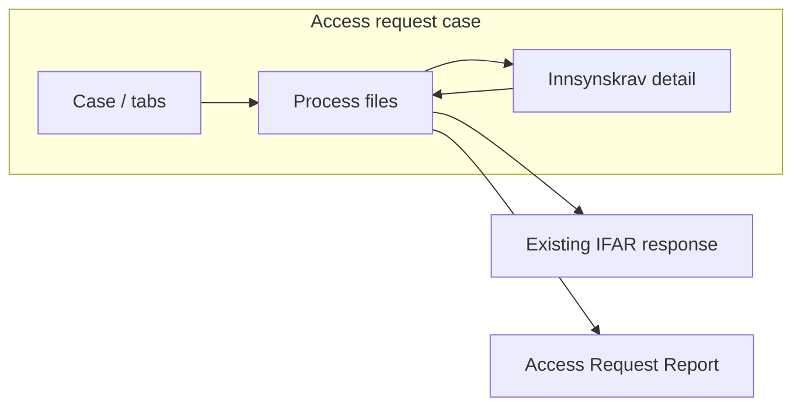

# Wireframes — IFAR file-first processing workspace

Low-fidelity HTML wireframes for stakeholder review. Not production UI.

## View

Open [index.html](./index.html) in a browser (double-click or `start index.html` from this folder).

| Screen | File | EXPERIENCE flow |
|--------|------|-----------------|
| Main workspace | [01-process-files-default.html](./01-process-files-default.html) | Flow 1 — Ingrid |
| Bulk blocked | [02-document-exception.html](./02-document-exception.html) | Flow 2 |
| Queue complete | [03-all-decided.html](./03-all-decided.html) | Flow 1 end |
| Request detail | [04-request-detail.html](./04-request-detail.html) | Flow 4 |
| Redaction mode | [05-redaction-mode.html](./05-redaction-mode.html) | Flow 3 + ArIn findings (v1.1) |

**2026-09-30 updates:** FIB FileViewer labels; file **size** column; **Archive Inspector** row badge + findings panel; **Sensitive findings** filter; **Denied vs Not assessed**; unsaved redaction banner; report **handoff** footer; classic **BIF** toggle.

Shared layout CSS: [wireframe.css](./wireframe.css).

## Screen flow (Mermaid)

## Excalidraw (optional)

For editable boxes-and-arrows, import screens into [Excalidraw](https://excalidraw.com) or recreate from these HTML layouts. BMad `.working/` Excalidraw can be added in a follow-up if needed.
