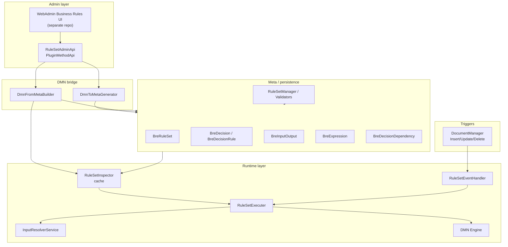

# BRE — Architecture (as implemented)

**Source:** Reverse-engineered from `core-bl` · **Date:** 2026-06-08

---

## System context

```
Public 360°
├── Meta layer (Case, Document, … CRUD via MetaStatement)
├── DocumentManagerEventShim
│       └── RuleSetEventHandler  ← gated by BusinessRuleEngineEnabled
├── RuleSetInspector (in-memory cache of Published rule sets)
├── RuleSetExecuter (DMN runtime)
├── ProcessPlatform DMN Engine (ProcessPlatform.RuntimeEngines.Dmn)
└── Admin surface
        ├── RuleSetAdminApi  (SurfaceCallable)
        ├── PluginMethodApi  (plugin catalog)
        └── Meta/Bre/* managers (CRUD validation, publish)
```

Admin UI (React webadmin, BIF menu) lives in **separate repos** — referenced by feature flag metadata only.

---

## Layered architecture



---

## Meta entity model

```
BusinessRuleSet (root)
├── TriggerType: Event | Job | Manual
├── TriggerSubType: OnInsert | OnUpdate | OnDelete
├── ContextEntity: Case | Document | … (10 enum values)
├── Status: Draft | Published | Archived
├── IsEnabled, BaseUID, Version, StartingPoint
├── PublishedDate, RuntimeState, LastLoadAt, LastLoadErrors
└── children:
    ├── BusinessRuleDecision (DecisionTable | Expression)
    │   └── DecisionExecutionType: None | RunProcess | ValidationMessage
    ├── BusinessRuleDecisionRule (table rows)
    ├── BusinessRuleInputOutput (inputs/clauses)
    ├── BusinessRuleExpression (FEEL / JS / …)
    ├── BusinessRuleDecisionDependency
    └── BusinessRuleKnowledgeSource (stub)
```

**Publish rules:** Published/archived content is immutable except Status, IsEnabled, RuntimeState, LastLoadAt, LastLoadErrors. Publishing unpublishes prior version in same BaseUID thread.

---

## Runtime execution flow

### 1. Startup

`RuleSetInspector.Initialize` → `Refresh()` → query all **Published** rule sets → build DMN from meta → validate XML → compile `DmnDefinition` → store in `ConcurrentDictionary<Guid, ExecutableRuleSet>`.

**Note:** Inspector initializes **regardless of feature flag**. Event handler does not.

### 2. Meta change

`RuleSetMetaInsert/Update.PostTransactionEvent` → full cache refresh (marked "temp approach" in code).

### 3. Entity CRUD event

```
DocumentManagerEventShim (9 events)
  → RuleSetEventHandler (if BusinessRuleEngineEnabled)
      → map entity → EnumBreContextEntity (skip if unsupported)
      → map event name → EnumBreTriggerSubType
      → RuleSetExecuter.ExecuteMatchingRuleSets(Event, subType)
          → RuleSetInspector.GetExecutableRuleSets (trigger match ONLY)
          → for each rule set:
              → resolve inputs (InputResolverService)
              → execute Decisions.LastOrDefault()  ⚠ not StartingPoint
              → HandleResult:
                  ValidationMessage → throw BizInfoException (blocks operation)
                  RunProcess → no-op ⚠
```

### 4. Input resolution

| ValueSource | Resolver | Status |
|-------------|----------|--------|
| Static | `StaticInputResolver` | Implemented |
| EntityField | `EntityFieldResolver` | Implemented |
| StatementField | `StatementFieldResolver` | Implemented |
| ManualInput | `ManualInputResolver` | Implemented (when dict passed) |
| SystemFunction | — | **Not implemented** |
| CustomFunction | — | **Not implemented** |

---

## Admin API surface

| Method | Purpose |
|--------|---------|
| `GetAdminRuleSetListItem()` | List all rule sets |
| `GetRuleSetDetails(recno)` | Details + regenerated DMN XML |
| `SaveRuleSet(SaveRuleSetProps)` | DMN XML → meta insert/update |
| `PublishRuleSet(recno, setEnabled?)` | Publish + enable/disable |
| `GetEntityAndTriggerTypeListOption()` | Designer options: Case (OnInsert, OnUpdate), Document (OnInsert) |

All methods throw if `BusinessRuleEngineEnabled` is off.

**PluginMethodApi:** scans `*pluginengine*` / `*rulesetplugin*` DLLs for `[Query]` and `[Action]` methods — catalog for designer only.

---

## Feature flag

| Property | Value |
|----------|-------|
| Toggle | `BusinessRuleEngineEnabled` |
| Type | Development |
| Default | **OFF** |
| Since | 6.6 |
| Work item | #370776 |
| Gates | `RuleSetEventHandler`, all admin APIs |
| Does not gate | `RuleSetInspector` cache load |

---

## Test architecture

| Layer | Location | Focus |
|-------|----------|-------|
| Unit | `SI.Biz.Core.ProcessPlatform.UnitTest/RulesEngine/` | Meta validation, DMN bridge, resolvers, admin API |
| Integration | `IntegrationTest.ProcessPlatform/RulesEngine/` | Meta handlers, DMN round-trip, cache load |
| Gap | — | No tests for `HandleResult`, event e2e, Job/Manual |

---

## Known architectural debt

1. **ContextEntity stored but not used in matching** — design intent vs implementation mismatch
2. **Full cache refresh on every meta change** — scalability concern at volume
3. **RuleSetExecuter is internal** — extension requires same assembly or wrapper
4. **Plugin discovery without execution bridge** — designer/backend disconnect
5. **Runtime diagnostic fields unused** — LastLoadErrors never populated at runtime
6. **Single-decision assumption violated** — uses Last decision, not StartingPoint

---

## Key source files

| Path | Role |
|------|------|
| `SI.Biz.Core.ProcessPlatform.RulesEngine/Runtime/RuleSetExecuter.cs` | Execution + actions |
| `SI.Biz.Core.ProcessPlatform.RulesEngine/Runtime/RuleSetInspector.cs` | Cache + matching |
| `SI.Biz.Core.ProcessPlatform.RulesEngine/Runtime/RuleSetEventHandler.cs` | Event wiring |
| `SI.Biz.Core.ProcessPlatform.Meta/Bre/` | Meta CRUD + validation |
| `SI.Client.Api.Process/RuleSet/Admin/RuleSetAdminApi.cs` | Admin surface |
| `SI.Biz.Core.ProcessPlatform.Shared/Types/RuleSetEnums.cs` | All BRE enums |
