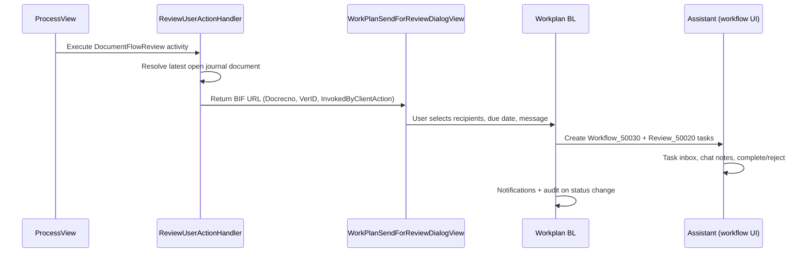
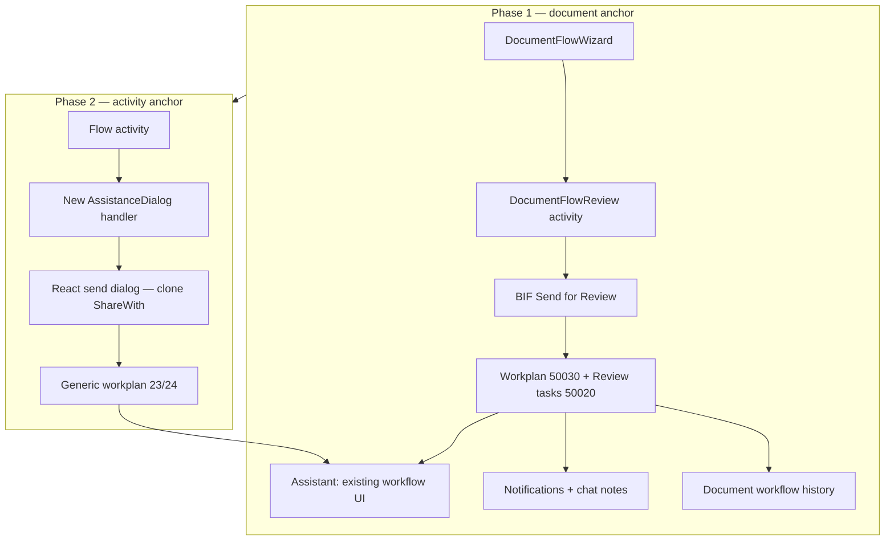

# 360 Flow — Ask for Assistance: Technical Feasibility

**Status:** Draft for architecture / tech lead review  
**Date:** 2026-09-10  
**Audience:** Architect, tech lead, product  
**Context:** NVE pilot requirement — ask a Public 360 user (outside the process model) to assist on work, with notification, dialogue, audit trail, and escalation if not followed up.

---

## 1. Summary

**Verdict:** Technically feasible. Phase 1 (document anchor) can reuse the existing **send-for-review / workplan** stack with **low-to-medium** Flow integration effort and **no BL changes** for a pilot. Phase 2 (activity anchor) is **medium-to-high** and needs new Flow integration glue, though the same workplan, notification, and assistant-side UI can be reused.

**Key insight:** This need is structurally similar to approval/review workflows in standard Public 360 — not to ShareWith. The product question is whether "assistance" can be delivered as **review workflow with relabelled semantics**, or whether a new workflow category is required.

**Recommended strategy:**

| Phase | Anchor | Approach | BL changes |
|-------|--------|----------|------------|
| **Phase 1** | Document | Configure `DocumentFlowReview` after `DocumentFlowWizard` | None (config + access) |
| **Phase 2** | Activity | New `AssistanceDialog` handler + React send dialog → generic workplan | Medium |

---

## 2. Business need (condensed)

NVE wants case workers to request help from someone who is:

- A **Public 360 user**, but **not** a defined process participant
- **Notified** when assistance is requested
- Able to engage in **back-and-forth dialogue**
- Subject to a clear **audit trail** visible to the process owner
- **Escalatable** if the request is not acted on

This is distinct from assigning the next process step to a role, and distinct from sharing full case access without structured follow-up.

---

## 3. Relationship to existing capabilities

### 3.1 Approval / review workflows (closest fit)

Standard Public 360 document workflows already provide:

| Need | Existing capability |
|------|---------------------|
| Notify recipient | Workflow task notifications (email + push) |
| Dialogue | Workflow chat notes (`WorkflowChatNote`) + dedicated notification types |
| Audit trail | Workplan + document workflow history |
| Due date / follow-up | Due dates on send-for-review/approval |
| Escalation / reassignment | Distribution groups (pick-up, registrar/admin reassignment); stand-ins |
| Recipient outside process | Workflows sent to any contact or distribution group |
| Scoped access | `[WORKFLOW_ACTORS]`, `[DISTRIBUTION_GROUP_MEMBERS]` access tokens |

Flow already integrates review/approval via `DocumentFlowReview` / `DocumentFlowApproval` work unit activities. These resolve to legacy BIF send dialogs, which create workplans and review/approval tasks in core BL.

### 3.2 ShareWith (partial fit, wrong semantics for tracking)

NVE already has an `AskForInternalAssistance` work unit built on `ShareWithDialog`:

- **Path:** `core-bl` → `WorkUnits/FlowWorkUnits/StandardProcesses/NVE Processes/AskForInternalAssistance.xaml`
- **Behaviour:** Pins/shares the **case** with selected contacts, then closes the activity
- **ProcessView:** Native React dialog (`CreateShareWithDialog`)
- **Gap:** No workplan tasks, no structured overdue/escalation, no formal assistance lifecycle

ShareWith is good for informal case sharing. It does not deliver the accountability model NVE described.

### 3.3 Process Task / Checkpoint (wrong fit)

`ProcessTask` / `Task` activities assign work to **process participants**. They do not route to arbitrary org users with workflow notifications and chat-note dialogue.

---

## 4. Technical architecture — how review works today

### 4.1 Flow → review handoff

**Key code references:**

| Component | Location | Role |
|-----------|----------|------|
| Review handler | `si-bl-process-platform-build/.../Review/ReviewUserActionHandler.cs` | Builds BIF URL; requires open journal document |
| Approval handler | `si-bl-process-platform-build/.../Approval/ApprovalUserActionHandler.cs` | Same pattern for approval |
| Workplan factory | `si-bl-core-build/SI.Biz.Core/Workplan/Process/WorkplanProcessFactory.cs` | Routes categories 20–25 to document/generic review/approval processes |
| Notifications | `WorkplanProcess.TaskStatusChange` | `WorkplanAlerts` + `WorkplanNotifications` on status change |
| Flow enum | `EnumActionType.DocumentFlowReview = 12`, `DocumentFlowApproval = 11` | Process Platform client action types |
| Workplan task types | `Review_50020`, `Approval_50021`, parent `Workflow_50030` | Codetable activity types |

### 4.2 ShareWith path (for comparison)

| Component | Location | Role |
|-----------|----------|------|
| Handler | `ShareWithUserActionHandler.cs` | `ShareCaseItems` → close activity |
| Gateway | `PinAndShareItemsGateway.cs` | Case-only share via `FolderManager.Share` |
| React UI | `core-360-react-views/.../CreateShareWithDialog/` | Native ProcessView dialog |
| API | `ShareWithDialogApi.cs` | `GetShareWithDialogProps`, `ExecuteShareWithUserAction` |

---

## 5. ProcessView integration reality

Not all Flow client actions have native React dialogs in ProcessView.

| Action type | ProcessView UX |
|-------------|----------------|
| ShareWith, Email, Meeting, Milestone, Stage, Process | Native React dialog |
| **DocumentFlowReview, DocumentFlowApproval** | **Legacy BIF modal** via `handleExecute` → `onClientActionExecution` |
| DocumentFlowWizard / Dispatch | Mixed |

**Reference:** `core-360-react-views/packages/process-components/src/ProcessView/Actions/executeImmediatelyHelper.ts`

Review/approval are intentionally excluded from the native dialog list. Functionally they work in ProcessView; UX is inconsistent with ShareWith and other modern dialogs.

**Pilot implication:** Phase 1 can ship with BIF send dialog. A React send-for-assistance wizard is optional polish, not a blocker for BL reuse.

---

## 6. Phase 1 — Document anchor

### 6.1 Feasibility: **High**

Phase 1 can be delivered as **configuration on existing building blocks** with no new activity types or workplan categories.

**Minimal implementation:**

1. Configure process step: `DocumentFlowWizard` → `DocumentFlowReview` (`CreateReviewN=true`)
2. Localize activity title as "Ask for assistance" (or equivalent)
3. Validate tenant access matrix includes `[WORKFLOW_ACTORS]` for assistants
4. Accept BIF send-for-review dialog in ProcessView for pilot
5. `InvokedByClientAction` already passed in BIF URL — links workplan back to Flow activity

NVE processes already use `DocumentFlowReview` extensively (e.g. `Kunngjoring.xaml`, `HearingProcess.xaml`).

### 6.2 What reuses as-is

| Layer | Reuse | Notes |
|-------|-------|-------|
| Work unit XAML / PMC config | Full | Pattern exists; copy NVE document + review blocks |
| Workplan BL | Full | Task lifecycle, statuses, events |
| Notifications + email | Full | `WorkplanNotifications`, `WorkplanAlerts` |
| Workflow chat notes | Full | Existing assistant dialogue surface |
| Distribution groups | Full | Contact groups, pick-up, reassignment |
| Assistant-side UI | Full | Standard workflow task experience (not ProcessView-specific) |
| Access control tokens | Full | `[WORKFLOW_ACTORS]`, distribution group tokens |

### 6.3 What does not come for free

| Gap | Impact | Effort to close |
|-----|--------|-----------------|
| BIF send dialog in ProcessView | UX inconsistency vs ShareWith/email | **High** if React wizard required; **None** if BIF accepted for pilot |
| Review semantics | Assistants see approve/reject, not "assistance complete" | Product/copy decision; or new workflow category later |
| Document prerequisite | Review handler fails without open journal document | Must wire after `DocumentFlowWizard`; no ad-hoc case-only assistance |
| Process owner visibility in ProcessView | Audit exists on document/workplan, not surfaced in phase view | **Medium** — read API + status indicator in ProcessView |
| Concurrent workflows | Ongoing approval on same document may block duplicate workflows | Tenant/process design constraint |

### 6.4 Phase 1 effort estimate

| Layer | Effort | Notes |
|-------|--------|-------|
| Work unit / PMC configuration | Low | No new XAML types required |
| BL changes | **None** (pilot) | Pure reuse |
| Access / notification config | Low | Tenant setup |
| ProcessView send UI | None (BIF) or High (React) | Product choice |
| ProcessView status panel | Medium | Optional enhancement |
| Localization | Low | NVE strings |

### 6.5 Phase 1 path comparison

| Path | BL reuse | Tracking / escalation | ProcessView send UX | Fit for NVE need |
|------|----------|----------------------|---------------------|------------------|
| **A: DocumentFlowReview** | High | Full (workplan) | BIF | **Recommended** |
| **B: ShareWith** | Medium | Weak | Native React | Informal sharing only |
| **C: DocumentFlowApproval** | High | Full | BIF | Only if sign-off required |

---

## 7. Phase 2 — Activity anchor

### 7.1 Feasibility: **Medium–High**

Generic workplan categories exist in core BL:

- `Genericsequential_23` → `GenericReviewSequential`
- `Genericparallel_24` → `GenericReviewParallel`
- `Genericapproval_25` → `GenericApproval`

However, Flow's integration layer is **document-bound today**:

- `ReviewUserActionHandler` / `ApprovalUserActionHandler` always resolve a journal document
- BIF send dialogs require `Docrecno` + `VerID` in query string
- `PinAndShareItemsGateway` shares **cases only**, not activities
- `ActivityPostExecutionStatements` handles DocumentFlow and ShareWith branches only

### 7.2 Phase 2 would require

1. **New or extended client action** — e.g. `AssistanceDialog` (`EnumActionType`) or extended review handler with anchor type (`document` | `activity`)
2. **New send entry point** — participant picker without document prerequisite; link workplan `ConnectedEntity` to Flow activity recno
3. **ProcessView React dialog** — clone ShareWith participant picker shell; call new BL API
4. **`ActivityPostExecutionStatements` extension** — new branch for assistance post-execution activities
5. **Optional:** New workplan category / status semantics if "assistance complete" must differ from approve/reject

### 7.3 Phase 2 effort estimate

| Layer | Effort | Notes |
|-------|--------|-------|
| New handler + client API | Medium | Follow ShareWith / Review handler patterns |
| Workplan category (if new semantics) | Medium–High | Metadata, statuses, email templates |
| React send dialog | Medium | Clone `CreateShareWithDialog` |
| Assistant-side UI | Low | Still standard workplan task UI |
| Activity anchoring in workplan | Medium | Generic review path exists; untested from Flow |
| ProcessView status / oversight | Medium | Same as phase 1 enhancement |

---

## 8. Recommended technical strategy

**Phase 1:** Prove the product model with zero BL changes. Configure `DocumentFlowReview`, accept BIF send UX, validate NVE scenarios end-to-end.

**Phase 2:** Add a thin Flow-specific layer (handler + React dialog) that creates a generic workplan anchored to the triggering activity, reusing the same assistant UI and notification stack.

---

## 9. Risks and open decisions

| # | Risk / decision | Owner | Notes |
|---|-----------------|-------|-------|
| 1 | BIF send dialog acceptable for NVE pilot? | Product + NVE | Functionally complete; UX debt vs ShareWith-native dialogs |
| 2 | Review semantics acceptable as "assistance"? | Product + NVE | Approve/reject framing may confuse; relabel or new category |
| 3 | Process owner oversight in ProcessView | Engineering | Audit exists in core; surfacing in phase view is additive work |
| 4 | Document-only constraint for phase 1 | Product | Many NVE scenarios may already have a document; validate with delivery |
| 5 | ShareWith vs review positioning | Product | Retire or reposition `AskForInternalAssistance` ShareWith work unit |
| 6 | React send wizard timing | Engineering | Defer to post-pilot unless NVE blocks on UX |
| 7 | Phase 2 activity anchor scope | Architect | Generic workplan reuse vs new assistance-specific category |

---

## 10. Validation plan (suggested)

### Phase 1 proof

Walk one NVE scenario on a tenant with Flow + document workflow configured:

1. Case worker creates document via `DocumentFlowWizard`
2. Executes "Ask for assistance" (`DocumentFlowReview` step)
3. BIF send dialog → select assistant outside process roles
4. Assistant receives task notification
5. Assistant replies via workflow chat note; requester notified
6. Assistant completes review task
7. Process owner verifies audit trail on document / workplan

**Pass criteria:** Notification, dialogue, audit, and overdue visibility work without custom BL.

### Phase 2 spike (before committing)

Timeboxed investigation (recommended 1–2 days):

- Can generic workplan (category 23/24) be created programmatically with activity recno as connected entity?
- What access tokens are needed for activity-anchored assistance?
- Minimal handler + API sketch; no UI until phase 1 validated

---

## 11. Codebase references (quick index)

| Topic | Path |
|-------|------|
| NVE assistance work unit (ShareWith) | `core-bl/.../NVE Processes/AskForInternalAssistance.xaml` |
| Review handler | `core-bl/.../Review/ReviewUserActionHandler.cs` |
| ShareWith handler | `core-bl/.../ShareWith/ShareWithUserActionHandler.cs` |
| Workplan factory | `core-bl/SI.Biz.Core/Workplan/Process/WorkplanProcessFactory.cs` |
| EnumActionType | `core-bl/.../Shared/Types/EnumActionType.cs` |
| ProcessView action routing | `core-360-react-views/.../Actions/executeImmediatelyHelper.ts` |
| ProcessView ShareWith dialog | `core-360-react-views/.../CreateShareWithDialog/` |
| Flow work unit skill (activity types) | `core-bl/.../skills/flowworkunit-new-process/SKILL.md` |
| Pilot status notes | `PM_productivity/.../flow/Flow_Pilot_Status_And_Learnings.md` |

---

## 12. Conclusion

Reusing approval/review workflow infrastructure for "ask for assistance" is **technically sound** for phase 1 with a document anchor. The BL, notification framework, chat-note dialogue, and assistant-side UI are mature and do not need to be rebuilt. The main trade-offs are:

1. **BIF send UX** in ProcessView (acceptable for pilot)
2. **Review semantics** vs assistance framing (product decision)
3. **Phase 2 activity anchor** requires new Flow integration, not just config

Do **not** build a parallel "assistance request" entity. Extend or configure the existing workplan pattern.

---

*Document prepared from product discovery and codebase analysis. For questions, contact product owner.*
