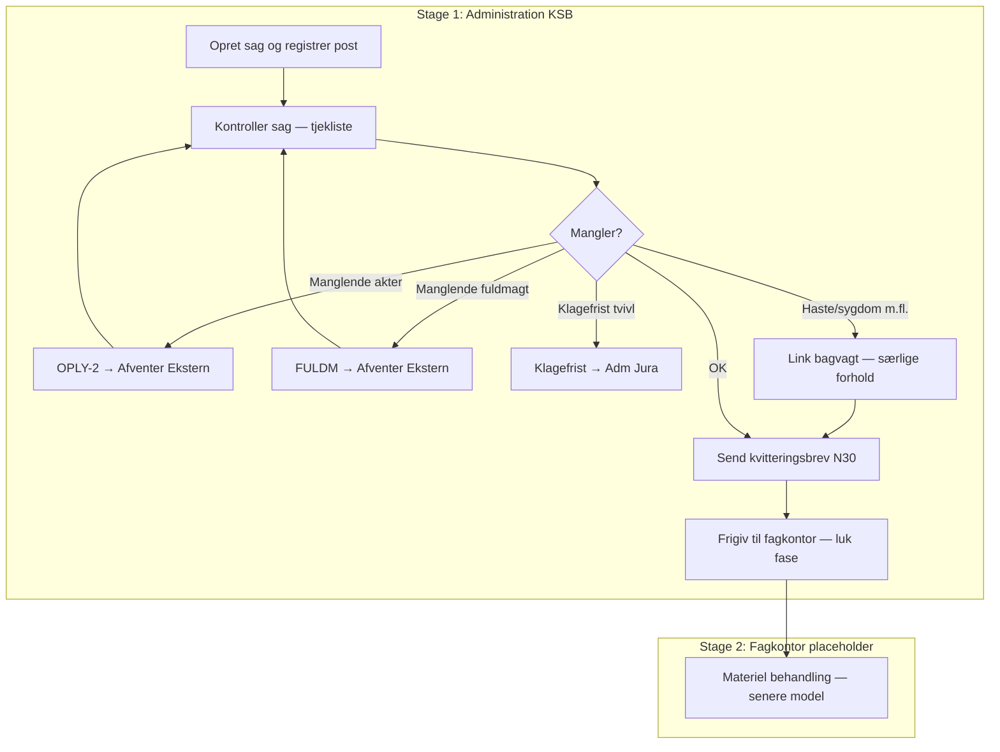

# AST KSB administration — Flow mapping (v1 draft)

**Source:** `administrative-vejledninger-for-adm-team-ksb-2.pdf` (tjekliste ud fra arbejdskopi, kvittering og frigivelse, opret ny sag)  
**Customer:** Ankestyrelsen (AST)  
**Scenario ID:** `AST-KSB-ADMIN-INTAKE`  
**Status:** Draft for review — not tenant-importable JSON yet

## Scope

| In scope | Out of scope (v1) |
|---|---|
| Adm KSB: modtagelse → kontrol → kvittering → frigivelse | Fagkontor materiel sagsbehandling (møde, ekstrakt, afgørelse) |
| OPLY-2 (manglende akter) | Aktindsigt, ASK robot-flow, klagefrist full Jura process |
| Fuldmagt-anmodning (FULDM) | Sanktioner / familieydelser faghåndbøger |
| Klagefrist → handoff Adm Jura | AI sagsassistent use cases |
| N30 / N30A kvittering (+ N30B haste note) | BESK-2 fristsag variant (se annotation) |
| Forløb KSB 28 dage | Posthåndtering på lukkede sager / efterbehandling |

## Process model overview

## Stages and milestones

### Stage 1 — Administration KSB — modtagelse og kontrol

| Milestone ID | Name | When registered |
|---|---|---|
| `m-anke-modtaget` | Anke modtaget | Sag oprettet, post journaliseret |
| `m-sagskontrol-gennemfort` | Sagskontrol gennemført | Tjekliste gennemført uden blokkerende mangler |
| `m-akter-anmodet` | Manglende akter anmodet (OPLY-2) | OPLY-2 sendt til førsteinstans |
| `m-fuldmagt-anmodet` | Fuldmagt anmodet | FULDM-brev sendt til borger |
| `m-klagefrist-til-jura` | Klagefrist henvist til Adm Jura | Link til Jura ved tvivl/overskridelse |
| `m-kvittering-sendt` | Kvitteringsbrev sendt | N30 / N30A (eller variant) afsendt |
| `m-frigivet-fagkontor` | Frigivet til fagkontor | Fase 1 lukket; trigger til stage 2 |

### Stage 2 — Fagkontor — materiel behandling (placeholder)

| Milestone ID | Name | When registered |
|---|---|---|
| `m-fagkontor-modtaget` | Sag modtaget i fagkontor | Ansvarlig enhed overført til fagkontor |

## Stage 1 — processes

| Process | Activity ID | Trigger | Key templates | Milestone output |
|---|---|---|---|---|
| Opret sag og registrer post | `act-opret-sag` | Sag modtaget fra km / post | — | Anke modtaget |
| Kontroller sag (arbejdskopi) | `act-kontroller-sag` | Efter oprettelse / akter modtaget | — | Sagskontrol gennemført |
| Anmod manglende akter | `act-anmod-akter-km` | Tjekliste #3 = nej | OPLY-2 | Manglende akter anmodet |
| Anmod fuldmagt | `act-anmod-fuldmagt` | Tjekliste #8 = nej | FULDM-1…12 | Fuldmagt anmodet |
| Henvis klagefrist | `act-henvis-klagefrist-jura` | Tjekliste #9 = nej/tvivl | — (link Jura) | Klagefrist → Jura |
| Link bagvagt | `act-link-bagvagt` | Tjekliste #10 | N30B (haste) | — |
| Send kvitteringsbrev | `act-send-kvittering` | Kontrol OK, klar til frigivelse | N30, N30A | Kvittering sendt |
| Frigiv fagkontor | `act-frigiv-fagkontor` | Efter kvittering | — | Frigivet til fagkontor |

**Concurrency:** Kontrol kan køre parallelt med registrering af efterfølgende post; deficiency-processer (OPLY-2, FULDM) er typisk sekventielle og blokerer frigivelse.

**Phase rule (from handbook):** Fase 1 lukkes **ikke** mens administration afventer akter eller fuldmagt.

## Checklist — milestones alignment

| Milestone (logical tag) | Items | Handbook reference |
|---|---|---|
| `ANKE_MODTAGET` | 1–2 | Opret sag, arbejdskopi |
| `SAGSKONTROL` | 3–10 | Tjekliste ud fra arbejdskopi |
| `KVITTERING` | 11–12 | Send kvitteringsbrev |
| `FRIGIVET` | 13 | Luk fase, status Ny sag |

### Checkpoints with deficiency outcomes

| # | Checkpoint | Outcome → process |
|---|---|---|
| 3 | Afgørelse, klage og genvurdering foreligger | OPLY-2 → Afventer Ekstern |
| 8 | Fuldmagtsforhold afklaret | FULDM → Afventer Ekstern |
| 9 | Klagefrist overholdt eller henvist | Link → Adm Jura (Afventer Intern) |
| 10 | Særlige oplysninger håndteret | Link bagvagt (+ N30B ved haste) |

## Letter / template inventory

| Skabelon | Brug i denne model |
|---|---|
| N30 | Standard kvittering til klient |
| N30A | Kvittering til partsrepræsentant |
| N30B | Hastebehandling (alm. KSB) |
| N30E / N30F / N34 | Variant kvitteringer — manuelt/rollebaseret |
| OPLY-2 | Manglende akter fra førsteinstans |
| FULDM-* | Manglende/upræcis fuldmagt |
| FRIST-6 | **Ikke** fra KSB — Adm Jura (`klagefrist.pdf`) |

## Deadlines and annotations

| Type | Note |
|---|---|
| Phase deadline | Forløb KSB 28 dage (planlagt afsluttet +28) |
| OPLY-2 svarfrist | 7/8 dage (digital post) eller 14/15 dage (fysisk) |
| Fuldmagt svarfrist | 7/8 dage (digital) eller 14/15 dage (fysisk) |
| Phase rule | Fase 1 lukkes IKKE mens der afventes akter eller fuldmagt |
| Building blocks | Reuse demo patterns: deficiency subprocess (OPLY-2), N30 dispatch, checkpoint before release |

## Known variants (separate models later)

1. **BESK-2 forsikrede ledige / seniorjob** — frigiv straks efter kontrol; indhent **ikke** akter i admin; resume beskriver mangler. Seniorjob: kvittering afventer fagkontor-vurdering af fristsag.
2. **Hastebehandling** — N30B eller særlig frase; link bagvagt; ved manglende akter først indhent, så N30B.
3. **Returpost** — genfremsend én gang (BREV-2); derefter fagkontor.

## Frigivelse — acceptance criteria (from handbook)

Sagen er korrekt frigivet når:

- Status = **Ny sag**
- Ansvarlig enhed = rette **fagkontor**
- Adgangsgruppe = **Social og Beskæftigelse** eller **Social og Børn**
- Ansvarlig person er **blank**

## Next steps toward tenant import

1. Review draft with AST Adm KSB (validate tjekliste, milestones, N30 play-flow).
2. Map logical `MilestoneType` tags to AST tenant `MilestoneTypeRecno` values.
3. Configure Work Unit arguments for OPLY-2 and N30 (reuse demo building blocks where possible).
4. Bind process model to KSB case types / application types in PMC.
5. Pilot on non-production tenant; compare handling time vs. manual checklist.

## Artefacts

| File | Purpose |
|---|---|
| `process-model-draft.json` | Flow IR (`flow-process-model-draft.schema.json`) |
| `checklist-draft.json` | Checklist structure for import tooling |
| `mapping.md` | This document |
