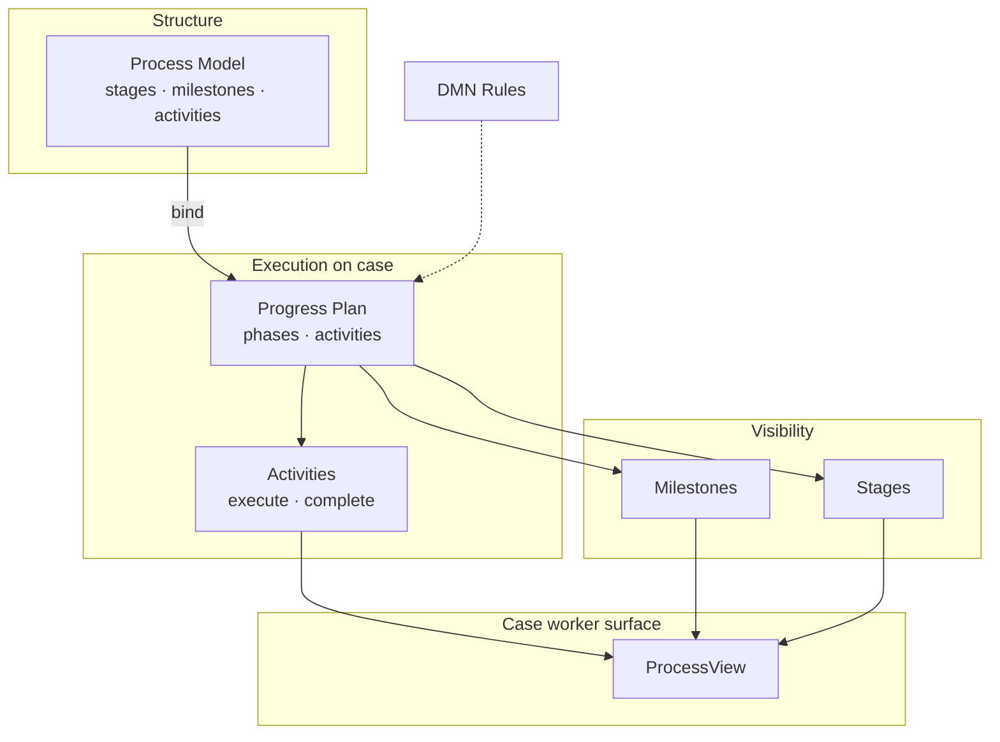

# Manuscript — Video 1: Flow introduction

| Field | Value |
|-------|--------|
| **Catalogue row** | Flow introduction |
| **Audience** | All (case workers, process builders, managers, implementation) |
| **Target length** | 8–9 minutes (~1,050 words narration) |
| **Language** | **English** (master); localized versions via AI + Clipchamp (see § Localization) |
| **Presenter** | Product or marketing (on-camera or voice-over on slides) |
| **Production format** | **Slides + screenshots** — minimal live product recording |
| **Tone** | Internal / controlled pilot — confident but bounded; no GA or licensing promises |
| **Recording status** | Draft v2 — 2026-05-18 |
| **Presenter notes** | `[NARRATION]` = spoken track; `[VISUAL]` = slide or screenshot asset ID |

---

## Production model (slides + screenshots)

Flow is still evolving. This video is designed so you **do not re-record the presenter** when the UI changes — only swap image assets.

### Three layers (edit separately in Clipchamp)

| Layer | What it is | Re-record when… |
|-------|------------|-------------------|
| **A — Presenter** | Talking head or voice-over on static slides | Messaging / positioning changes |
| **B — Slides** | PowerPoint / corporate template: concepts, tables, roadmap | Terminology or series structure changes |
| **C — Screenshots** | Still captures from pilot tenant (anonymized) | UI layout changes — **swap PNG only** |

### Recommended shot mix

| Type | Approx. share | Notes |
|------|---------------|--------|
| Slides only | ~55% | Scenes 1–3, 4 (concept map), 5, 6, 7 |
| Screenshot + light VO | ~35% | Scene 3 (ProcessView), Scene 4 (annotated stills) |
| Presenter to camera | ~10% | Optional: opening and close only |

### Screenshot hygiene

- Use a **dedicated internal/pilot tenant**; no real person names or case titles in frame.
- Blur or replace: case numbers, kommune names, user names, document titles.
- Export **PNG at 1920×1080**; name files `SS-01`, `SS-02`, … (asset list below).
- Add **callout boxes** in PowerPoint or Clipchamp (not burned into source PNG) so annotations can move without new captures.

### What we deliberately avoid

- Long screen recordings or cursor walkthroughs
- Executing activities live (“click complete”) — saves a dedicated video later
- Feature lists that go stale (pilot scope / emerging capabilities) — **not in this intro**

---

## Localization (English master → other languages)

| Step | Tool | Action |
|------|------|--------|
| 1 | This manuscript | Record **English** narration from Appendix A |
| 2 | Clipchamp | Edit master timeline (layers A + B + C) |
| 3 | Clipchamp **Translate & dub** (or equivalent) | Generate target-language audio from English VO |
| 4 | Review | Native speaker checks terminology: *Process model*, *Progress plan*, *ProcessView*, *PAF* |
| 5 | On-screen text | Translate slide text in source deck **or** use Clipchamp captions — keep product terms consistent |
| 6 | Screenshots | Usually **language-neutral** if UI is localized in tenant; re-capture only if labels must match locale |

**Tip:** Keep slide body text short; put detail in narration so dubbing carries the story. Product names stay in English unless you have official Norwegian market names signed off.

---

## Learning objectives

When the viewer finishes this video, they should be able to:

1. Explain what **360° Flow** is in one sentence and how it differs from generic workflow/BPM tools.
2. Name the **five core building blocks** (process model, progress plan, activities, milestones/stages, ProcessView) without confusing them.
3. Describe **who** typically uses Flow in a pilot (case worker vs process builder vs manager).
4. Choose the **next video** in the training series for their role.

---

## Visual asset list

### Slides (designer / marketing)

| ID | Slide title | Used in |
|----|-------------|---------|
| SL-01 | 360° Flow — Introduction (*Pilot training series*) | Scene 1, 7 |
| SL-02 | Pilot disclaimer (*Internal pilot — not GA · Licensing not final*) | Scene 1 |
| SL-03 | Why Flow? — The tension (standardization ↔ adaptation) | Scene 2 |
| SL-04 | Without Flow / With Flow (optional two-column) | Scene 2 |
| SL-05 | What Flow **is** | Scene 3 |
| SL-06 | What Flow is **not** (4 bullets) | Scene 3 |
| SL-07 | Concept map (diagram — see § Concept map asset) | Scene 4 |
| SL-08 | Five concepts — one line each (build animation optional) | Scene 4 |
| SL-09 | Who Flow is for (role table) | Scene 5 |
| SL-10 | Training series — what to watch next (3 tracks) | Scene 6 |
| SL-11 | End card — link / QR (internal URL TBD) | Scene 6, 7 |

### Screenshots (implementation / PM captures)

| ID | Capture | Annotate in edit |
|----|---------|------------------|
| SS-01 | Case overview — entry to Flow (case with process visible) | Optional arrow to process area |
| SS-02 | **ProcessView** full width — `DMS/CaseDetails/ProcessView` | Callouts: phases, activity list, one activity row |
| SS-03 | ProcessView — **activity list** crop (zoom) | Highlight execute/edit affordances if visible |
| SS-04 | *(Optional)* Admin / PMC glimpse — “where builders work” | Single frame; no configuration detail |

**Refresh policy:** When ProcessView changes, replace SS-02 and SS-03 only; slides and presenter track stay.

---

## Before you record

### Environment (for screenshots only)

| Requirement | Detail |
|-------------|--------|
| Tenant | Pilot or internal tenant with Flow enabled |
| Case | One case with bound process model and populated ProcessView |
| Data | Anonymized before export |

### Presenter (product / marketing)

- Comfortable explaining **positioning**, not clicking through admin configuration.
- If on camera: record **Scenes 1 and 7** in one short session; remaining scenes can be **voice-over on slides**.
- Read from Appendix A; pace ~130 words/minute.

### Legal / comms (once, Scene 1)

- Flow is **internal and controlled pilot** — not GA.
- **Licensing and packaging are not final.**

---

## Scene-by-scene script

*Times assume voice-over on slides; screenshot beats add ~5–10 s each.*

### Scene 1 — Opening (0:00–0:45)

| | |
|---|---|
| **[VISUAL]** | SL-01 → SL-02 (3 s) → optional presenter on camera |
| **[NARRATION]** | Welcome to the first video in the **360° Flow** training series. Flow is the operational layer in Public 360° for structured processes on cases — formerly known internally as **PAF**, the Process Automation Framework. This series supports **pilot and internal audiences**: implementation partners, selected customers, and our teams validating Flow before general release. In the next eight minutes: what Flow is, the core concepts, who it is for, and which video to watch next for your role. |

---

### Scene 2 — Why Flow exists (0:45–2:00)

| | |
|---|---|
| **[VISUAL]** | SL-03 → SL-04 (optional) — **slides only** |
| **[NARRATION]** | Public-sector case handling balances **equal treatment**, **traceability**, and **auditability** with **local adaptation** and efficient daily work. Without a governed process layer, teams often face fragmented follow-up: manual coordination, weak visibility of where cases are in a procedure, and inconsistent progression. **360° Flow** puts **structured, lifecycle-aware progression** inside the case — not a separate BPM tool on the side, but part of how Public 360° works with cases, documents, and roles. Flow helps you **standardise** repeatable processes, **reduce manual coordination**, and **see status** — phases, milestones, and stages — where case workers work. |

---

### Scene 3 — What Flow is (and is not) (2:00–3:45)

| | |
|---|---|
| **[VISUAL]** | SL-05 (narration) → SL-06 (narration) → **SS-02** with callouts (hold 8–12 s) |
| **[NARRATION]** | So what **is** Flow? Flow is the **governed operational execution layer** for Public 360°: **process models** on cases, **progress plans** in execution, **activities** completed by users, **rules** where configured — and **ProcessView** as the main surface for case workers. Shorthand: **Public 360°-native process execution**, not a generic low-code workflow product. What Flow is **not**: not a full BPM suite; not the legacy **Workflow webpart** line — Flow uses the **Process Platform** runtime and ProcessView; **AI-assisted** modelling is **future direction**, not this pilot; **Hosted Processes** — sector packages on top of Flow — apply only if your tenant is explicitly enabled. On screen you see **ProcessView** — the operational home on the case. We tour it in a later video; for now, remember: **this is where Flow lives for day-to-day work**. |

---

### Scene 4 — Core concepts (3:45–6:15)

| | |
|---|---|
| **[VISUAL]** | SL-07 (full map) → SL-08 (step through 1–5, or simple builds) → **SS-02** or **SS-03** with numbered callouts matching narration |
| **[NARRATION]** | Five concepts you will hear in every Flow conversation. **One — Process model:** the **structure** — stages, milestones, activities — the blueprint you bind to cases. **Two — Progress plan:** when a model runs on a case, the **executable** flow for *this* case — phases, activities, done and next. **Three — Activities:** the steps case workers **execute** — dialogs, complete, sometimes cancel or reactivate. **Four — Milestones and stages:** milestones mark lifecycle points — often for reporting; stages organise the broader lifecycle. Builders have a dedicated video on triggers, including documents. **Five — ProcessView:** the primary UI — phases, activity lists, actions. If you remember one surface, remember ProcessView. Two builder terms for later: **Rules** — often **DMN** at runtime; **Building blocks** — reusable patterns from the process library. If model and plan still blur, watch **Progress plans vs process models** next in the series. |

*Screenshot sync:* When you say “ProcessView”, show SS-02 with callout **5**. When you say “activities”, pulse callout on activity list (**SS-03** optional).

---

### Scene 5 — Who Flow is for (6:15–7:15)

| | |
|---|---|
| **[VISUAL]** | SL-09 — role table |
| **[NARRATION]** | Flow is **role-governed**. **Case workers** work in **ProcessView** — executing activities. **Process builders** and **implementation** configure models, stages, milestones, and automation — admin and PMC — covered in builder-track videos. **Managers** follow progression on cases; broader portfolio views come in a later video when that surface matures. **Registrars** support registration quality and binding where configured. You do not need every role on day one — follow the track that matches your job. |

---

### Scene 6 — How this series continues (7:15–8:30)

| | |
|---|---|
| **[VISUAL]** | SL-10 → SL-11 |
| **[NARRATION]** | Where next? **Everyone:** **Process models**, then **Progress plans vs process models** — shared vocabulary. **Case workers:** **ProcessView: your operational home on the case**, then **Activities and the activity dialog**, then **Working with processes**. **Process builders:** **Stages and stage templates**, **Milestones and triggers**, then **Setting up your first process**; save the **deficiency letter** capstone until you have covered wait tasks and document milestones. **Admins and implementation:** **Enabling Flow in your tenant** when you own rollout. Not sure Flow is enabled? Contact your **implementation lead** before the builder track. |

---

### Scene 7 — Close (8:30–9:00)

| | |
|---|---|
| **[VISUAL]** | SL-01 (end card) — optional presenter |
| **[NARRATION]** | You have the map: Flow is Public 360°’s governed operational layer; **process models** structure work; **progress plans** run it on the case; **activities** are what people do; **ProcessView** is where they do it. Thanks for watching. Go deeper with **What Flow is — and is not**, or continue with **Process models**. See you in the next video. |

---

## Concept map asset (for SL-07)

---

## Clipchamp assembly guide

1. **Import** English VO (or record in Clipchamp) per scene as separate clips — easier to re-dub per scene later.
2. **Place** slide PNGs / PPT exports on video track 1.
3. **Place** screenshots on track 1 with **crossfade** from slide — avoid hard cuts from face to UI.
4. **Callouts:** use Clipchamp shapes/text so SS-02 does not need re-export for annotation tweaks.
5. **Export** English master → duplicate project → **Translate & dub** for each locale.
6. **Captions:** generate from final dubbed audio; fix product terms in caption editor.

---

## Recording checklist

- [ ] English master recorded from Appendix A  
- [ ] SL-01 through SL-11 designed in corporate template  
- [ ] SS-01–SS-03 captured and anonymized  
- [ ] Pilot disclaimer visible (SL-02)  
- [ ] No live screen recording longer than 15 s total  
- [ ] No licensing/pricing quotes  
- [ ] No AI features shown or promised  
- [ ] “Formerly PAF” once; primary name **360° Flow**  
- [ ] Scene 6 (old pilot scope list) **omitted** — scope detail left to wiki / later videos  
- [ ] Clipchamp project structured in layers A / B / C  

---

## Appendix A — Full narration (English teleprompter)

*Scenes 1–7 only. ~1,050 words.*

Welcome to the first video in the 360° Flow training series. Flow is the operational layer in Public 360° for structured processes on cases — formerly known internally as PAF, the Process Automation Framework. This series supports pilot and internal audiences: implementation partners, selected customers, and our teams validating Flow before general release. In the next eight minutes: what Flow is, the core concepts, who it is for, and which video to watch next for your role.

Public-sector case handling balances equal treatment, traceability, and auditability with local adaptation and efficient daily work. Without a governed process layer, teams often face fragmented follow-up: manual coordination, weak visibility of where cases are in a procedure, and inconsistent progression. 360° Flow puts structured, lifecycle-aware progression inside the case — not a separate BPM tool on the side, but part of how Public 360° works with cases, documents, and roles. Flow helps you standardise repeatable processes, reduce manual coordination, and see status — phases, milestones, and stages — where case workers work.

So what is Flow? Flow is the governed operational execution layer for Public 360°: process models on cases, progress plans in execution, activities completed by users, rules where configured — and ProcessView as the main surface for case workers. Shorthand: Public 360°-native process execution, not a generic low-code workflow product. What Flow is not: not a full BPM suite; not the legacy Workflow webpart line — Flow uses the Process Platform runtime and ProcessView; AI-assisted modelling is future direction, not this pilot; Hosted Processes — sector packages on top of Flow — apply only if your tenant is explicitly enabled. On screen you see ProcessView — the operational home on the case. We tour it in a later video; for now, remember: this is where Flow lives for day-to-day work.

Five concepts you will hear in every Flow conversation. One — Process model: the structure — stages, milestones, activities — the blueprint you bind to cases. Two — Progress plan: when a model runs on a case, the executable flow for this case — phases, activities, done and next. Three — Activities: the steps case workers execute — dialogs, complete, sometimes cancel or reactivate. Four — Milestones and stages: milestones mark lifecycle points — often for reporting; stages organise the broader lifecycle. Builders have a dedicated video on triggers, including documents. Five — ProcessView: the primary UI — phases, activity lists, actions. If you remember one surface, remember ProcessView. Two builder terms for later: Rules — often DMN at runtime; Building blocks — reusable patterns from the process library. If model and plan still blur, watch Progress plans vs process models next in the series.

Flow is role-governed. Case workers work in ProcessView — executing activities. Process builders and implementation configure models, stages, milestones, and automation — admin and PMC — covered in builder-track videos. Managers follow progression on cases; broader portfolio views come in a later video when that surface matures. Registrars support registration quality and binding where configured. You do not need every role on day one — follow the track that matches your job.

Where next? Everyone: Process models, then Progress plans vs process models. Case workers: ProcessView — your operational home on the case, then Activities and the activity dialog, then Working with processes. Process builders: Stages and stage templates, Milestones and triggers, then Setting up your first process; save the deficiency letter capstone until wait tasks and document milestones. Admins and implementation: Enabling Flow in your tenant. Not sure Flow is enabled? Contact your implementation lead before the builder track.

You have the map: Flow is Public 360°’s governed operational layer; process models structure work; progress plans run it on the case; activities are what people do; ProcessView is where they do it. Thanks for watching. Go deeper with What Flow is — and is not, or continue with Process models. See you in the next video.

---

## Appendix B — Review sign-off

| Reviewer | Focus |
|----------|--------|
| Product (@Tone / @Morten J.) | Positioning, concept map, series order |
| Marketing | Slide template, presenter tone, end-card link |
| Implementation | Screenshot tenant; SS-02 reflects current ProcessView |
| P&S | Internal-only distribution; localization markets |

---

*Sources: `360_Flow_PRD_Reconstruction_Unredacted_v4.md`, `360_Flow_6.10_Release_Note_DRAFT.md` §C, training catalogue. v2: slides/screenshots production, no pilot-scope scene, English master + Clipchamp localization.*
